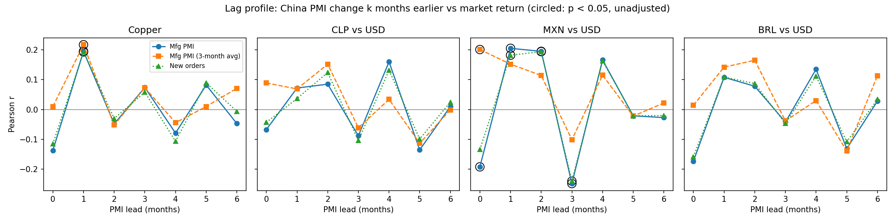

# Niche Alpha: China PMI vs LATAM markets

Does China's factory activity give an early hint about copper and Latin American currencies?

This project matches China's official PMI with COMEX copper and three LATAM currencies
(Chilean peso, Mexican peso, Brazilian real) month by month, tests same-month and
one-month-lead correlations, and presents the results in an interactive Streamlit dashboard.

## Main conclusion (updated 22 Nov 2026)

**China's PMI does not reliably lead copper or LATAM currencies in this data.** An apparent
one-month lead (r ≈ 0.2) comes almost entirely from the COVID shock: excluding Feb–Apr 2020
removes it. The same holds for the PMI **new orders** sub-index and for **Granger causality tests**
in both directions. What does explain these markets' monthly moves is the **US dollar**
(about 30–48% of monthly moves, same month). See the sections below.

## First-pass correlations (Nov 2016 – Oct 2026, 118–119 months)

*Week 2 table, kept for the record. The CLP column used monthly-average rates and is superseded by the
month-end results in "Daily Chilean peso data" below; the other columns are unchanged.*

| China indicator | Copper | CLP | MXN | BRL |
|---|---|---|---|---|
| Manufacturing PMI change, same month | −0.14 | −0.03 | −0.19* | −0.17 |
| Manufacturing PMI change, previous month | 0.20* | 0.03 | 0.21* | 0.11 |
| Non-manufacturing PMI change, same month | −0.14 | −0.02 | −0.13 | −0.17 |
| Non-manufacturing PMI change, previous month | 0.16 | 0.04 | 0.22* | 0.13 |

Pearson r between the monthly PMI change and each market's monthly return
(currencies: positive = stronger vs USD). \* p < 0.05, approximate, not adjusted for multiple tests.

- A rise in China's PMI is followed **the next month** by slightly better copper returns and a slightly stronger Mexican peso.
- Same-month links are near zero.
- The Chilean peso showed almost no link here — mainly a data problem (monthly-average rates), fixed below.

**Caveat:** these are weak relationships (PMI explains about 4% of next month's moves) and they do not
survive the robustness check below.

## Robustness check

| Result | All 118 months | Without Feb–Apr 2020 |
|---|---|---|
| PMI change → copper, next month | r = 0.20 (p ≈ 0.03) | r = 0.02 (p ≈ 0.87) |
| PMI change → Mexican peso, next month | r = 0.21 (p ≈ 0.02) | r = −0.06 (p ≈ 0.50) |

- **Why:** in Feb 2020 China's PMI fell 14.3 points to 35.7, then rose 16.3 points in March. These two
  extreme months line up with large copper and currency moves and drive the whole correlation.
- **Rolling 36-month correlation:** the link appears in March 2020 and disappears exactly 36 months later,
  when those months leave the window — the signature of a single outlier, not a stable relationship.
- **Lag scan (0–6 months, 6 PMI versions incl. new orders, 4 markets = 168 tests):** 17 results at p < 0.05
  (about 8–9 expected by chance); **none survive a Bonferroni correction.**




## Dollar control and out-of-sample test

**Controlling for the US dollar** (Broad US Dollar Index, FRED DTWEXBGS). Regression of each monthly
return on last month's PMI change plus this month's dollar move (% return per 1-point PMI change, or per 1% dollar move):

| Market | PMI, no control | PMI, with dollar control | Dollar (same month) |
|---|---|---|---|
| Copper | +0.52 (p ≈ 0.03) | +0.35 (p ≈ 0.09) | −2.0 (p < 0.001) |
| Mexican peso | +0.32 (p ≈ 0.02) | +0.19 (p ≈ 0.07) | −1.5 (p < 0.001) |
| Chilean peso | +0.12 (p ≈ 0.44) | −0.02 (p ≈ 0.89) | −1.5 (p < 0.001) |
| Brazilian real | +0.19 (p ≈ 0.24) | +0.06 (p ≈ 0.67) | −1.6 (p < 0.001) |

The dollar dominates; PMI is not significant anywhere once it is included (or once COVID is excluded).

**Out-of-sample:** fitted on Dec 2016 – Dec 2022, tested on Jan 2023 – Oct 2026 (46 months). Test-period
correlations are near zero (copper 0.07, MXN −0.01, CLP −0.01, BRL 0.03), and out-of-sample R² versus
predicting the average return is +0.9% for copper and −0.5% to −1.9% for the currencies — no useful predictive power.

## NBS new orders index

Rebuilt from **35 official NBS English press releases** (13-month sub-index table in each), because the
NBS database was not reachable from outside China (`fetch_new_orders_nbs.py`). Strict checks, all passed:
column order verified in every table; 117 months appear in 2+ releases with identical values; headline PMI
matches the AkShare series for all 132 months; 9 independent published values match; no missing months.
Feb–Apr 2018 and Oct 2026 come from a single release (Mar/Apr 2018 independently confirmed).

Result: new orders behaves like the headline PMI — one-month lead on copper r = 0.19 (p ≈ 0.03), falling to
r = 0.02 (p ≈ 0.84) without COVID.

## Daily Chilean peso data

Banco Central de Chile *dólar observado*, daily, via mindicador.cl, cross-checked against the Chilean tax
authority (SII) tables: **100% identical on all 2,709 common days** (`fetch_clp_daily.py`). The rate dated D
reflects the previous banking day's trades, so month-end = first value published in the next month; averaging
by trade date reproduces the OECD/FRED monthly averages (mean difference 0.07%), confirming this timing.

| Check | Monthly-average CLP (old) | Month-end CLP (new) |
|---|---|---|
| Last month's copper → this month's peso (r) | 0.34 | −0.03 |
| Granger test copper → peso (1 lag) | p ≈ 0.001 | p ≈ 0.27 |
| Same-month copper vs peso (r) | 0.43 | 0.56 |
| Share of peso moves explained by the US dollar | 20% | 44% |

The apparent "copper predicts the peso" effect was an **averaging artifact**. With month-end data the peso
behaves like the other currencies: it moves with copper and the dollar in the same month.

## Granger causality tests

Does the past of X help predict Y beyond Y's own past? F-tests at 1, 2 and 3 monthly lags, both directions
(China → markets, markets → China, copper ↔ CLP); identical to statsmodels' implementation (`granger_tests.py`).

| Sample | Tests | p < 0.05 | Survive Bonferroni |
|---|---|---|---|
| All months | 54 | 14 (~3 expected by chance) | 3 (PMI / new orders → MXN at 2–3 lags) |
| Excluding COVID (Feb–Apr 2020) | 54 | 0 | 0 |

Every apparent link disappears once the COVID shock is excluded.

## Data sources

| Series | Source |
|---|---|
| China manufacturing and non-manufacturing PMI | National Bureau of Statistics, via [AkShare](https://github.com/akfamily/akshare) |
| COMEX copper futures (HG), month-end close, US cents/lb | Sina Finance, via AkShare |
| MXN, BRL per USD (daily, month-end) | FRED: DEXMXUS, DEXBZUS |
| CLP per USD (daily, month-end) | Banco Central de Chile dólar observado via mindicador.cl; cross-checked with SII; FRED CCUSMA02CLM618N used as a check |
| NBS manufacturing New Order Index | NBS English PMI press releases (stats.gov.cn) |
| Broad US Dollar Index | FRED: DTWEXBGS |

## Files

| File | Purpose |
|---|---|
| `data_fetcher_v2.py` | Downloads PMI and copper; builds `pmi_copper_matched.csv`. Stops if a download fails (no substituted data). |
| `analyzer_v2.py` | Same-month and one-month-lead correlations; saves `lag_results.csv` and two charts. |
| `latam_heatmap.py` | Adds currencies and non-manufacturing PMI; saves `latam_monthly.csv`, `heatmap_results.csv`, `correlation_heatmap.png`. |
| `lag_scan.py` | Leads of 0–6 months for 6 PMI versions (incl. new orders); rolling 36-month correlation; saves `lag_scan_results.csv`, `rolling_correlation.csv`, `lag_profile.png`, `rolling_correlation.png`. |
| `robustness_v2.py` | Dollar control and out-of-sample test; saves `robustness_results.csv`, `usd_index_monthly.csv`. |
| `fetch_new_orders_nbs.py` | NBS new order index from official press releases (strict checks); saves `china_new_orders.csv`, adds it to `latam_monthly_plus.csv`. |
| `fetch_clp_daily.py` | Daily CLP (two sources), month-end rates; saves `clp_daily.csv`, `clp_month_end.csv`; updates `latam_monthly_plus.csv` (old averages kept in `latam_monthly_plus_clp_avg.csv`). |
| `granger_tests.py` | Granger causality tests, both directions; saves `granger_results.csv`. |
| `app.py` | Streamlit dashboard (reads the saved CSVs; no live data). Lead slider 0–6, COVID on/off switch, new-orders option, lag profile, rolling correlation, dollar panel, trilingual commentary. |

## Run it

```bash
python -m venv .venv
source .venv/bin/activate
pip install -r requirements.txt akshare
python data_fetcher_v2.py
python analyzer_v2.py
python latam_heatmap.py
python fetch_new_orders_nbs.py
python fetch_clp_daily.py
python lag_scan.py
python robustness_v2.py
python granger_tests.py
streamlit run app.py
```

## Method notes

- Monthly returns are calculated from month-end values for all markets (CLP: first dólar observado of the next month).
- NBS publishes PMI at month-end, so pairing month *t*'s PMI change with month *t+1*'s return uses only information public at the time.
- Correlation p-values use a normal approximation; Granger p-values use the exact F distribution.

## Next steps

- Deploy the dashboard on Streamlit Cloud.
- Extend copper history before Nov 2016 (current source starts there).

## Development

Built with AI coding assistance (Claude). Data choices, checks and interpretation by the author.
