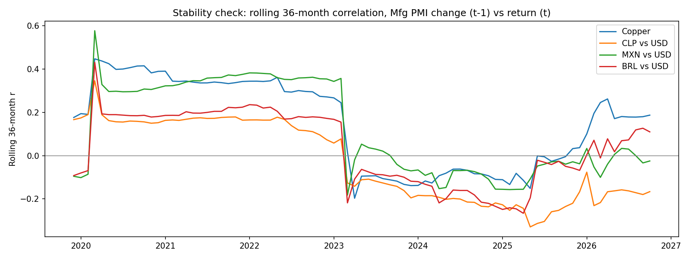

# Niche Alpha: China PMI vs LATAM markets

Does China's factory activity give an early hint about copper and Latin American currencies?

This project matches China's official PMI with COMEX copper and three LATAM currencies
(Chilean peso, Mexican peso, Brazilian real) month by month, tests same-month and
one-month-lead correlations, and presents the results in an interactive Streamlit dashboard.

## Main conclusion (updated 21 Nov 2026)

**China's PMI does not reliably lead copper or LATAM currencies in this data.** An apparent
one-month lead (r ≈ 0.2) comes almost entirely from the COVID shock: excluding Feb–Apr 2020
removes it. See *Robustness check* below.

## First-pass correlations (Nov 2016 – Oct 2026, 118–119 months)

| China indicator | Copper | CLP | MXN | BRL |
|---|---|---|---|---|
| Manufacturing PMI change, same month | −0.14 | −0.03 | −0.19* | −0.17 |
| Manufacturing PMI change, previous month | 0.20* | 0.03 | 0.21* | 0.11 |
| Non-manufacturing PMI change, same month | −0.14 | −0.02 | −0.13 | −0.17 |
| Non-manufacturing PMI change, previous month | 0.16 | 0.04 | 0.22* | 0.13 |

Pearson r between the monthly PMI change and each market's monthly return
(currencies: positive = stronger vs USD). \* p < 0.05, approximate, not adjusted for multiple tests.

- A rise in China's PMI is followed **the next month** by slightly better copper returns and a slightly stronger Mexican peso.
- Same-month links are near zero.
- The Chilean peso shows almost no link (its data is a monthly average rate, which may weaken it).

**Caveat:** these are weak relationships (PMI explains about 4% of next month's moves) and they do not
survive the robustness check below.

## Robustness check

| Result | All 118 months | Without Feb–Apr 2020 |
|---|---|---|
| PMI change → copper, next month | r = 0.20 (p ≈ 0.03) | r = 0.02 (p ≈ 0.87) |
| PMI change → Mexican peso, next month | r = 0.21 (p ≈ 0.02) | r = −0.06 (p ≈ 0.50) |

- **Why:** in Feb 2020 China's PMI fell 14.3 points to 35.7, then rose 16.3 points in March. These two
  extreme months line up with large copper and currency moves and drive the whole correlation.
- **Rolling 36-month correlation:** the link appears in March 2020 and disappears exactly 36 months later,
  when those months leave the window — the signature of a single outlier, not a stable relationship.
- **Lag scan (0–6 months, 4 PMI versions, 4 markets = 112 tests):** 11 results at p < 0.05 (about 5–6
  expected by chance); **none survive a Bonferroni correction.**




## Data sources

| Series | Source |
|---|---|
| China manufacturing and non-manufacturing PMI | National Bureau of Statistics, via [AkShare](https://github.com/akfamily/akshare) |
| COMEX copper futures (HG), month-end close, US cents/lb | Sina Finance, via AkShare |
| MXN, BRL per USD (daily, month-end) | FRED: DEXMXUS, DEXBZUS |
| CLP per USD (monthly average) | FRED: CCUSMA02CLM618N (OECD) |

## Files

| File | Purpose |
|---|---|
| `data_fetcher_v2.py` | Downloads PMI and copper; builds `pmi_copper_matched.csv`. Stops if a download fails (no substituted data). |
| `analyzer_v2.py` | Same-month and one-month-lead correlations; saves `lag_results.csv` and two charts. |
| `latam_heatmap.py` | Adds currencies and non-manufacturing PMI; saves `latam_monthly.csv`, `heatmap_results.csv`, `correlation_heatmap.png`. |
| `lag_scan.py` | Leads of 0–6 months for 4 PMI versions; rolling 36-month correlation; saves `lag_scan_results.csv`, `rolling_correlation.csv`, `lag_profile.png`, `rolling_correlation.png`. |
| `app.py` | Streamlit dashboard (reads the saved CSVs; no live data). Lead slider 0–6, COVID on/off switch, lag profile, rolling correlation, trilingual commentary. |

## Run it

```bash
python -m venv .venv
source .venv/bin/activate
pip install -r requirements.txt akshare
python data_fetcher_v2.py
python analyzer_v2.py
python latam_heatmap.py
python lag_scan.py
streamlit run app.py
```

## Method notes

- Monthly returns are calculated from month-end values (CLP: monthly average).
- NBS publishes PMI at month-end, so pairing month *t*'s PMI change with month *t+1*'s return uses only information public at the time.
- p-values use a normal approximation.

## Next steps

- Control for the US dollar (regress returns on lagged PMI plus a dollar index).
- Granger causality tests in both directions.
- Out-of-sample test (fit 2016–2022, test 2023–2026).
- Daily Chilean peso data (current CLP series is a monthly average).
- NBS new-orders sub-index (data.stats.gov.cn was not reachable from outside China).

## Development

Built with AI coding assistance (Claude). Data choices, checks and interpretation by the author.
